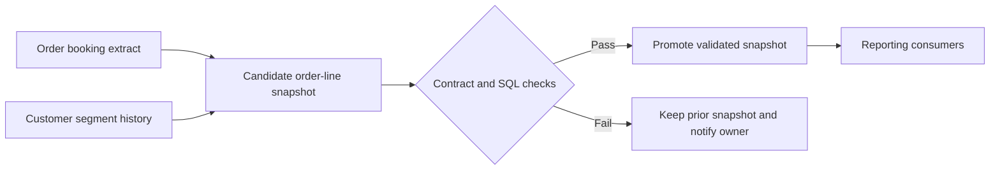

# Data Architecture & Governance

A fictional retailer is replacing inconsistent order dashboards with a shared data product. This case study records the decisions behind the design and shows how platform engineers, domain owners, and stewards would operate it. It accompanies the Enterprise Order Model SQL demo. All records, operating targets, and roles are examples.

| Artifact | Design question |
| --- | --- |
| [Decision 001 · Historical customer segment](decisions/001-historical-segment.md) | How should historical reporting behave when a customer changes segment or a source corrects history? |
| [Decision 002 · Governed publishing](decisions/002-governed-publishing.md) | What should happen when the next refresh fails validation? |
| [Order-line data contract](order-line-contract.md) | What can consumers rely on, and how do changes get introduced? |
| [Control matrix](control-matrix.md) | Who owns each control, how does it run, and what evidence does it leave? |

The companion demo implements the model, joins, and SQL checks. Snapshot promotion, role provisioning, alerting, evidence capture, and retention are proposed operating controls.
